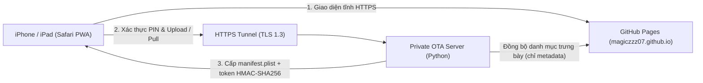

  

<h1 align="center">MagicZ — Private iOS OTA Store (PWA)</h1>

  Cổng phân phối và cài đặt file <code>.ipa</code> đã ký chứng chỉ trực tiếp lên iPhone / iPad qua giao thức Apple OTA (<code>itms-services://</code>), đóng gói dạng PWA cho cảm giác sử dụng như ứng dụng gốc.

  <a href="https://magiczzz07.github.io">Truy cập MagicZ Store</a>

---

## Hệ thống này dùng để làm gì?

Khi các công cụ cài trực tiếp phổ biến (ESign, InstallOnAir, Dropbox direct link...) gặp lỗi chứng chỉ máy chủ hoặc bị chặn chuyển hướng HTTP 302 trên iOS 17/18, **MagicZ** giải quyết khâu **lưu trữ và cài đặt OTA trực tiếp** cho các file `.ipa` bạn đã tự ký bằng chứng chỉ **UDID (Ad-Hoc / Development)** hoặc **Enterprise**.

- **Không phụ thuộc dịch vụ bên thứ ba**: Không bị giới hạn dung lượng 50 MB hay 100 MB của các nền tảng lưu trữ miễn phí.
- **Trải nghiệm Native PWA trên iOS**: Hỗ trợ `Service Worker`, `site.webmanifest` (`display: standalone`), vùng an toàn tai thỏ / Dynamic Island và thanh điều hướng đáy màn hình khi ghim ra Màn hình chính iPhone.
- **Chế độ Kho trưng bày (Private Vault)**: Người ngoài truy cập chỉ thấy danh mục ứng dụng đang lưu trữ; chỉ chủ sở hữu xác thực mã PIN trực tiếp với máy chủ mới được mở khóa nút **Install**, nạp file mới hoặc xóa bản dựng.

---

## Tính năng nổi bật

- **Cài đặt 1 chạm qua Safari iOS**: Tự động sinh `manifest.plist` chuẩn Apple và kích hoạt giao thức `itms-services://`.
- **Tự động tách Icon gốc từ `.ipa`**: Bộ giải mã **Apple CgBI PNG sang RGBA PNG** giúp hiển thị đúng biểu tượng thật của ứng dụng trên giao diện kho và ngoài màn hình chính iPhone trong lúc cài.
- **Phân tích `.ipa` trực tiếp trên trình duyệt**: Đọc nhanh `Info.plist` (cả định dạng nhị phân `bplist00` lẫn XML) và `embedded.mobileprovision` ngay bằng JavaScript mà không cần tải toàn bộ file lên trước.
- **Hai chế độ nạp ứng dụng**:
  - **Tải file `.ipa` trực tiếp**: Tự chia nhỏ thành từng gói 20 MB, tải ổn định các ứng dụng hoặc game dung lượng vài trăm MB đến nhiều GB từ iPhone (ứng dụng Tệp / ESign) hoặc máy tính.
  - **Kéo từ link Dropbox / Direct HTTPS**: Máy chủ tự chuẩn hóa đường dẫn và tải file về kho riêng, khắc phục triệt để lỗi redirect của Dropbox trên iOS mới.
- **Chuyển động icon mượt mà**: Tích hợp cục bộ [MorphIcons](https://github.com/guillermolg00/morphicons) (vật lý lò xo SVG, không phụ thuộc CDN ngoài) cho các trạng thái khóa/mở khóa, tải xuống và sao chép.
- **Tiện ích lấy mã UDID**: Tích hợp sẵn hồ sơ cấu hình `enroll.mobileconfig` giúp lấy nhanh UDID thiết bị ngay trên iPhone.

---

## Kiến trúc tổng quan

---

## Yêu cầu để tự triển khai

Nếu anh em muốn tự dựng một hệ thống tương tự cho cá nhân hoặc nhóm nhỏ, cần chuẩn bị:

1. **Thiết bị iOS & File `.ipa` đã ký**:
   - File `.ipa` đã được ký sẵn chứng chỉ chứa **UDID** của máy (hoặc chứng chỉ Enterprise còn hạn).
   - Trên **iOS 16 / 17 / 18+**: Bật **Chế độ nhà phát triển (Developer Mode)** tại *Cài đặt > Quyền riêng tư & Bảo mật > Chế độ nhà phát triển*.
   - Bắt buộc mở trang bằng trình duyệt **Safari** (các trình duyệt nhúng trong Zalo, Telegram, Messenger chặn giao thức `itms-services://`).
2. **Giao diện Web tĩnh (Frontend)**:
   - Một repository công khai trên **GitHub Pages** (tự động có chứng chỉ SSL chuẩn Apple).
   - Không cần Vercel hay Supabase.
3. **Máy chủ lưu trữ & xử lý IPA (Self-hosted Backend)**:
   - Một máy tính cá nhân hoặc Mini PC chạy **Python 3.10+**.
   - **Cloudflare Tunnel (`cloudflared`)** để mở đường truyền HTTPS công khai mà không cần mở port router hay mua IP tĩnh.
   - Ổ cứng trống đủ chứa các file `.ipa` cần cài.

---

## Nguyên tắc bảo mật

Hệ thống được tách biệt hoàn toàn giữa **giao diện công khai** và **máy chủ riêng tư**:

- **Không chứa bí mật trên GitHub**: Mã PIN quản trị, mật khẩu, biến môi trường (`.env`), khóa SSH, token và file chứng chỉ ký (`.p12`, `.mobileprovision`) **không bao giờ** được đưa vào mã nguồn hay lịch sử Git.
- **Không thể giải mã từ mã nguồn trình duyệt (`Ctrl+U`)**: Mã PIN chỉ được xác thực phía máy chủ bằng so sánh hằng số thời gian (`HMAC`), kèm cơ chế tự động khóa tạm thời khi dò sai nhiều lần.
- **Liên kết cài đặt có chữ ký và tự hết hạn**: Mọi đường dẫn `manifest.plist` và `app.ipa` đều yêu cầu chữ ký **HMAC-SHA256** có thời hạn ngắn, chỉ được cấp sau khi xác thực PIN thành công.
- **Bảo vệ quyền riêng tư UDID**: Danh sách UDID trong chứng chỉ được băm một chiều bằng **SHA-256** trước khi đối chiếu, không bao giờ hiển thị danh sách UDID thô ra công khai.
- **Chính sách trình duyệt nghiêm ngặt**: Áp dụng `Content-Security-Policy` khóa cứng (`script-src 'self'`, `style-src 'self'`, không dùng `unsafe-inline`), loại bỏ `innerHTML`, chặn bot lập chỉ mục (`robots.txt` + `noindex`) và bảo vệ chống SSRF khi kéo đường dẫn ngoài.

---

## Cài đặt ra màn hình chính iPhone (PWA)

1. Mở [https://magiczzz07.github.io](https://magiczzz07.github.io) bằng **Safari** trên iPhone.
2. Bấm biểu tượng **Chia sẻ (Share)** ở thanh công cụ phía dưới -> chọn **Thêm vào MH chính (Add to Home Screen)**.
3. Mở biểu tượng **MagicZ** ngoài màn hình chính, bấm **Mở khóa** và nhập mã PIN riêng tư của bạn để bắt đầu sử dụng.

---

## Tuyên bố miễn trừ trách nhiệm

Công cụ này chỉ phục vụ mục đích lưu trữ, kiểm thử nội bộ và cài đặt các bản dựng ứng dụng iOS mà người dùng có quyền hợp pháp. Người sử dụng tự chịu trách nhiệm về nội dung tệp `.ipa` và chứng chỉ ký của mình.
